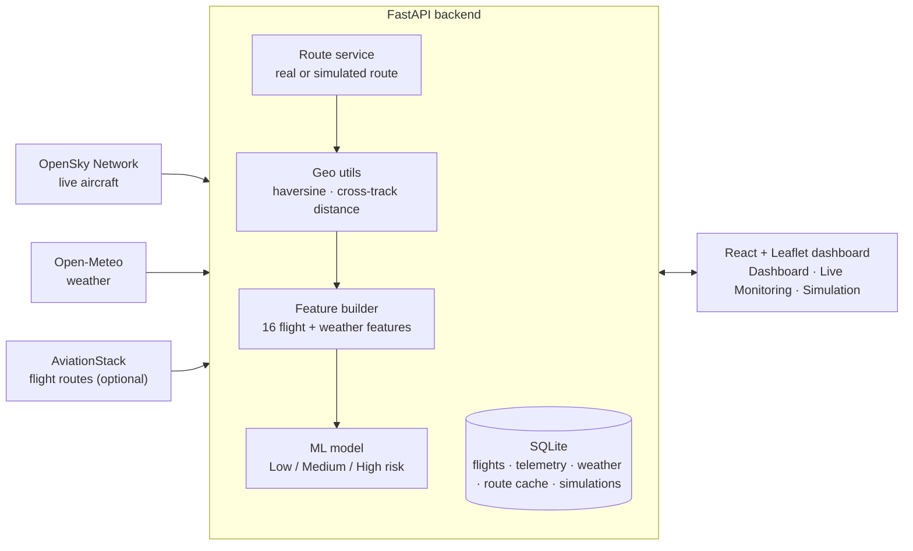

<div align="center">

# ✈️ Airway Route Deviation Prediction System

**Tracks live aircraft, compares where each flight is against where it should be, and predicts route-deviation risk from flight and weather data.**


[Features](#features) · [How it works](#how-it-works) · [Quick start](#quick-start) · [API](#api) · [ML model](#ml-model) · [Project structure](#project-structure)

</div>

---

## Overview

Built during my machine learning internship. The system pulls live aircraft positions from the **OpenSky Network**, attaches current weather from **Open-Meteo**, works out each flight's route, and measures how far the aircraft has drifted from it. A trained classifier turns those flight and weather features into a **Low / Medium / High** route-deviation risk, shown on a live map.

A **Simulation Mode** lets you create your own flights, plan a weather-aware route with intermediate waypoints, and replay recorded telemetry.

## Features

- 🛰️ **Live aircraft tracking** — worldwide positions from the OpenSky Network, clustered on an interactive Leaflet map.
- 🌦️ **Weather integration** — wind, temperature, pressure, humidity and visibility at each aircraft's position (Open-Meteo, no API key needed).
- 🗺️ **Route resolution** — real flight routes via AviationStack when a key is set, otherwise a simulated route from the nearest airports; results are cached in the database.
- 📍 **Deviation detection** — great-circle (haversine) and cross-track distance between the aircraft and its planned route.
- 🤖 **Risk prediction** — ML classifier over 16 flight and weather features, served from the API.
- 🧭 **Weather-aware route planning** — generates waypoints between origin and destination and checks weather along the way.
- 🎮 **Simulation mode** — add, edit and delete flights, start simulation sessions, and replay telemetry.
- 🐳 **Deployable** — Docker Compose for dev, QA and production, plus Kubernetes manifests.

## How it works



## Tech stack

| Layer | Technology |
|---|---|
| Frontend | React 18, Vite, Tailwind CSS 4, React Router, Leaflet + react-leaflet (marker clustering), Axios |
| Backend | Python, FastAPI, Pydantic, SQLAlchemy, SQLite |
| Machine learning | scikit-learn (Logistic Regression, Random Forest, Gradient Boosting), XGBoost, pandas, NumPy |
| Data sources | OpenSky Network, Open-Meteo, AviationStack (optional), `airportsdata` |
| DevOps | Docker, Docker Compose (dev / QA / prod), Nginx, Kubernetes |

## Quick start

**Requirements:** Python 3.11+ and Node.js 18+.

**Windows:** double-click **`run.bat`**. It starts the API and the dashboard in two windows and fetches the first batch of live aircraft.

**Manually:**

```bash
git clone https://github.com/NinadPandith/ML_INTERNSHIP.git
cd ML_INTERNSHIP

# Backend
cd backend
python -m venv .venv
source .venv/bin/activate          # Windows: .venv\Scripts\activate
pip install -r requirements.txt
cp .env.example .env               # optional: add OpenSky / AviationStack credentials
uvicorn app.main:app --reload --port 8000

# Frontend (second terminal)
cd frontend
npm install
npm run dev
```

Open **http://localhost:5173**. Interactive API docs are at **http://localhost:8000/docs**.

**With Docker:**

```bash
docker compose up --build
```

See [DEV_GUIDE.md](DEV_GUIDE.md), [QA_GUIDE.md](QA_GUIDE.md) and [PROD_GUIDE.md](PROD_GUIDE.md) for each environment.

### Environment variables (`backend/.env`)

| Variable | Required | Purpose |
|---|---|---|
| `OPENSKY_USERNAME`, `OPENSKY_PASSWORD` | No | Higher OpenSky rate limits; anonymous access works without them |
| `AVIATIONSTACK_API_KEY` | No | Real flight routes; without it, routes are simulated from nearby airports |

## API

| Method | Endpoint | Description |
|---|---|---|
| `GET` | `/api/health` | Health check |
| `GET` | `/api/live-aircraft` | Live aircraft positions (`?refresh=true` to pull fresh data) |
| `GET` | `/api/live-weather/{icao24}` | Weather at an aircraft's position |
| `GET` | `/api/live-dashboard` | Summary for the dashboard |
| `GET` | `/api/route/{callsign}` | Planned route for a flight |
| `GET` | `/api/history` | Stored aircraft telemetry |
| `POST` | `/api/predict` | Predict route-deviation risk |
| `POST` | `/api/flights` | Create a flight (plus `GET`, `PUT`, `DELETE`) |
| `POST` | `/api/simulation/start` | Start a simulation session |
| `GET` | `/api/simulation/{flight_id}/weather-route` | Weather-aware route with waypoints |
| `GET` | `/api/simulation/{session_id}/replay` | Replay a session's telemetry |

Full request and response schemas are in the interactive docs at `/docs`.

## ML model

The training pipeline is in [`backend/ml/`](backend/ml/):

1. [`pipeline.py`](backend/ml/pipeline.py) cleans the collected telemetry and engineers features.
2. [`train.py`](backend/ml/train.py) labels each record **Low / Medium / High** risk using aviation-inspired rules (weather severity, visibility, wind speed, altitude change, deviation percentage), then trains and compares Logistic Regression, Random Forest, Gradient Boosting and XGBoost, and keeps the one with the best F1 score.
3. The best model, the scaler and the label encoder are saved to `backend/ml/models/` and loaded by the API at start-up.

**Features (16):** altitude, speed, heading, wind speed, temperature, pressure, humidity, visibility, altitude change, speed change, heading change, wind effect, route distance, weather severity score, deviation distance, deviation percentage.

> **Note:** the labels come from rules rather than recorded incidents, and the current dataset is small, so the model learns those rules rather than real-world outcomes. Training on a larger set of historical flights is the main next step.

## Project structure

```
├── backend/
│   ├── app/
│   │   ├── main.py              FastAPI app and routes
│   │   ├── models.py            SQLAlchemy models
│   │   ├── schemas.py           Pydantic schemas
│   │   ├── crud.py              Database operations
│   │   ├── services/            OpenSky, weather and route services
│   │   ├── ml/                  Model loading and prediction
│   │   └── utils/geo.py         Haversine, bearing, cross-track distance
│   ├── ml/                      Data pipeline, training script, saved models
│   └── tests/                   Service tests
├── frontend/
│   └── src/
│       ├── pages/               Dashboard, Live Monitoring, Simulation, flight forms
│       ├── components/          Navbar, sidebar, notifications
│       └── services/api.js      API client
├── e2e_tests/                   End-to-end tests
├── k8s/                         Kubernetes deployments and services
├── docker-compose*.yml          Dev, QA and production stacks
└── run.bat                      One-click start on Windows
```

## Roadmap

- [ ] Train on a larger historical flight dataset with real deviation outcomes
- [ ] Alerts when a tracked flight crosses a risk threshold
- [ ] PostgreSQL for production deployments

## Author

**Ninad Pandith** · [GitHub](https://github.com/NinadPandith)
